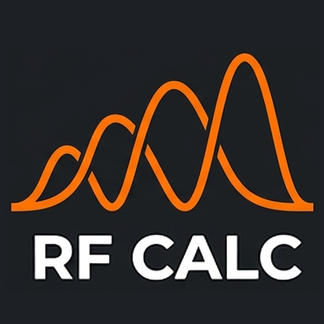
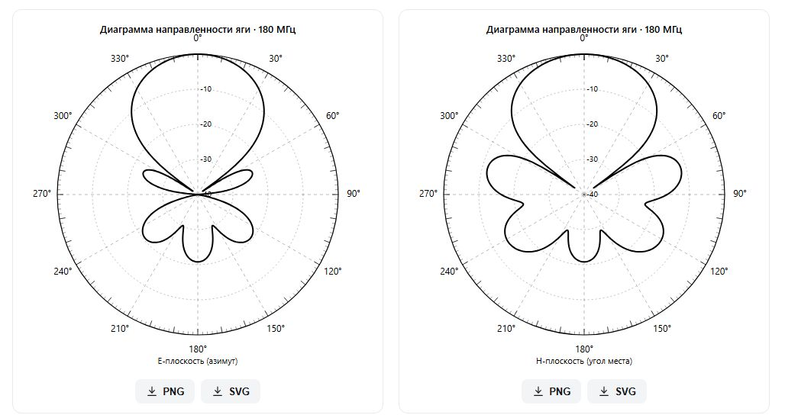

# RF CALC

**Antenna design, geometry analysis and radiation-pattern export — on your computer or in your browser.**

English · [Русский](#русский)

**[Release downloads](https://github.com/TimHardLite/rf-calc/releases/tag/v1.0.0-beta.1)** · **[Download source ZIP](https://github.com/TimHardLite/rf-calc/archive/refs/heads/main.zip)** · **[Step-by-step setup](docs/INSTALLATION.md)** · **[Donate / Поддержать](https://app.lava.top/hardlite)**

> **First public beta: 1.0.0-beta.1**, based on internal v3. The interface is Russian; documentation is available in English and Russian. Native installers are not available yet.

RF CALC helps turn antenna dimensions into readable radiation patterns and engineering estimates, or turn design targets into an initial geometry. It combines eight antenna families, dimensional sketches, two working modes, optional size optimization, SWR plots and editable `.irta` project files.

## What you can do

- Design or analyse dipoles, rectangular patches, pyramidal horns, uniform linear arrays, Yagi–Uda antennas, Moxon rectangles, log-periodic dipole arrays and GNSS-oriented helix assemblies.
- Inspect E/H pattern cuts, beamwidth, directivity and available gain, impedance, efficiency and SWR metrics. Available results depend on the model.
- Optimize supported dimensions, compare before/after results, and explicitly apply the result.
- Save both forms and selected geometry in a human-readable `IRTANT/2` project; read legacy `IRTANT/1` files.
- Export pattern plots as SVG or PNG and the SWR chart as PNG.
- Run calculations locally in the browser. The supplied application has no calculation server, account system or subscription backend.

## Choose how to run it

| Option | Best for | Status |
|---|---|---|
| Browser build | Trying RF CALC; Windows, Linux or macOS with a modern browser | Source and ready-to-serve web ZIP in Releases |
| Self-hosted static site | A lab, home server or shared domain | Caddy deployment instructions included |
| Docker Compose | Repeatable hosting on a server or Docker Desktop | Configuration supplied; container runtime verification pending |
| Tauri desktop | A normal application window and native file dialogs | Source included; release installers **not available yet** |
| Developer mode | Editing or debugging source | Node.js/npm; additional Rust/platform tools for Tauri |

Start with [installation and hosting](docs/INSTALLATION.md). A hidden PowerShell launcher is not a separate distribution: it would still need a runtime and a running process. The planned desktop installer is the more convenient end-user route.

## Documentation

| Guide | Contents |
|---|---|
| [User guide](docs/USER-GUIDE.md) | Workflow, every action, optimizer, charts, files and examples |
| [Field reference](docs/FIELDS.md) | All 142 field definitions in both modes, defaults, ranges and conditional visibility |
| [IRTA format](docs/IRTA.md) | File grammar, compatibility, complete example and generator rules |
| [Installation](docs/INSTALLATION.md) | Local browser, native builds, Windows/Linux hosting, domains and Docker |
| [Development](docs/DEVELOPMENT.md) | Structure, tests, debugging, contributions and documentation updates |
| [Models and validation](docs/MODELS.md) | Algorithms, assumptions, evidence and limitations |
| [Changelog](CHANGELOG.md) | Release history in chronological order |
| [Release procedure](docs/RELEASING.md) | Consistent versions, checks, packages and release notes |

## Engineering scope

The calculation code is implemented in TypeScript using method-of-moments solvers and analytical/empirical models. **RF CALC does not embed HFSS, NEC, MININEC or MMANA and is not a certified replacement for those tools.** Automated tests cover specific cases and invariants; they do not establish universal physical accuracy. Read the model notes before using a result for construction or a product specification.

## Support and license

Voluntary support: **[Support RF CALC on Lava.top](https://app.lava.top/hardlite)**. Donations are optional and do not unlock application features.

License: **not yet selected**. Public source access does not grant an open-source license; no additional permission to redistribute or relicense the application is granted here. Dependencies retain their own licenses; see [third-party notes](THIRD-PARTY-NOTICES.md).

## Project background

Created by **Timur Gabzalilov**, a design engineer at **IRT**, for the company's antenna-engineering workflow and at its request. IRT develops and manufactures UAVs and related hardware/software in Ufa, Russia. Public company details and contact information: [IRT attribution](docs/ABOUT-IRT.md), [official website](https://www.irtsolution.com/).

---

# Русский

**Проектирование антенн, поверочный расчёт и экспорт диаграмм направленности — на компьютере или в браузере.**

> **Первый публичный бета-выпуск: 1.0.0-beta.1**, на основе внутренней v3. Интерфейс русский; документация — на английском и русском. Готовых установщиков пока нет.

RF CALC строит диаграммы и рассчитывает характеристики по геометрии антенны либо подбирает начальные размеры по исходным требованиям. В программе восемь семейств антенн, размерные схемы, два режима, оптимизация поддерживаемых размеров, графики КСВ и редактируемые файлы `.irta`.

**[Скачать исходники ZIP](https://github.com/TimHardLite/rf-calc/archive/refs/heads/main.zip)** · **[Пошаговая установка](docs/INSTALLATION.md#русский)** · **[Поддержать проект](https://app.lava.top/hardlite)**

## Возможности

- Диполь, прямоугольный патч, пирамидальный рупор, равномерная линейная решётка, яги, Moxon, ЛПА и спиральные сборки GNSS.
- Сечения ДН E/H, ширина луча, КНД и доступные для выбранной модели КУ, импеданс, КПД и КСВ.
- Оптимизация размеров с таблицей «было/стало» и отдельным применением результата.
- Сохранение обеих форм и выбранной геометрии в `IRTANT/2`; чтение старых `IRTANT/1`.
- Экспорт ДН в SVG/PNG и графика КСВ в PNG.
- Расчёты выполняются на устройстве пользователя. Сервер расчётов, аккаунты и платные подписки в текущую программу не входят.

## Варианты запуска

| Вариант | Для кого | Готовность |
|---|---|---|
| Браузер | Быстро попробовать на Windows/Linux/macOS | Исходники и готовый веб-ZIP в Releases |
| Собственный сайт | Лаборатория, домашний сервер, свой домен | Инструкция для Caddy |
| Docker Compose | Повторяемое развёртывание | Конфигурация готова; запуск контейнера ещё не проверен |
| Tauri desktop | Обычное окно приложения и системные диалоги | Исходники есть; готовых установщиков пока нет |
| Режим разработчика | Изменение и отладка кода | Node.js/npm; для Tauri дополнительно Rust и системные инструменты |

Начните с [установки и размещения](docs/INSTALLATION.md#русский). Скрытый PowerShell не является отдельным форматом приложения: ему всё равно нужны среда и работающий процесс. Для обычного пользователя удобнее будущий настольный установщик.

## Документация

- [Использование: режимы, действия, оптимизация и графики](docs/USER-GUIDE.md#русский).
- [Все 142 определения полей: значения, диапазоны и условия](docs/FIELDS.md#русский).
- [Формат IRTA и правила генерации файлов](docs/IRTA.md#русский).
- [Установка, сервер, домен и Docker](docs/INSTALLATION.md#русский).
- [Разработка, проверки и отладка](docs/DEVELOPMENT.md#русский).
- [Модели и границы достоверности](docs/MODELS.md#русский).
- [История изменений](CHANGELOG.md#русский) и [порядок выпуска](docs/RELEASING.md#русский).

## Границы применения

Расчёты реализованы на TypeScript: собственные решатели методом моментов и аналитические/эмпирические модели. **В программу не встроены HFSS, NEC, MININEC или MMANA; она не является их сертифицированной заменой.** Тесты проверяют конкретные случаи, а не гарантируют точность любой конструкции. Перед изготовлением и переносом характеристик в паспорт изучите ограничения модели.

## Поддержка и лицензия

Добровольная поддержка: **[Поддержать RF CALC на Lava.top](https://app.lava.top/hardlite)**. Донаты необязательны и не открывают дополнительные функции программы.

Лицензия: **пока не выбрана**. Публичный доступ к коду не означает открытую лицензию; дополнительное разрешение на распространение или смену лицензии здесь не предоставляется. Лицензии зависимостей действуют отдельно: [сторонние компоненты](THIRD-PARTY-NOTICES.md).

## О проекте

Проект создан **Тимуром Габзалиловым**, инженером-конструктором **ООО «ИРТ»**, для задач компании и по её заказу. ИРТ разрабатывает и производит БПЛА и связанные программно-аппаратные решения в Уфе. [Краткая информация и публичные реквизиты](docs/ABOUT-IRT.md), [сайт компании](https://www.irtsolution.com/).
