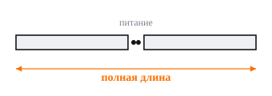
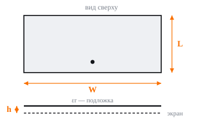
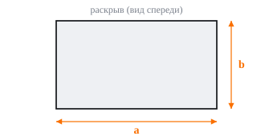
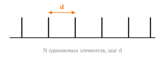
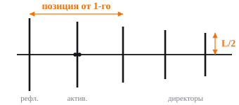
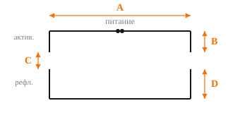
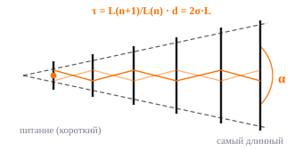
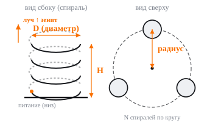

# Dimension sketches

[Home](../README.md) · [Русский](#русский)

Exported directly from the existing application components. These are symbolic dimension guides, not manufacturing drawings. Labels match the Russian UI.

## Dipole

## Patch

## Horn

## Uniform array

## Yagi-Uda

## Moxon

## LPDA

## GNSS helices

---

# Русский

Схемы выгружены из компонентов приложения. Это обозначения размеров, а не рабочие чертежи для изготовления.

## Диполь

## Патч

## Рупор

## Решётка

## Яги

## Moxon

## ЛПА

## GNSS-спирали

