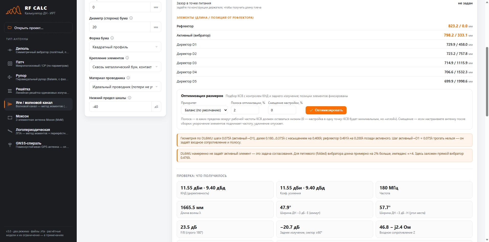
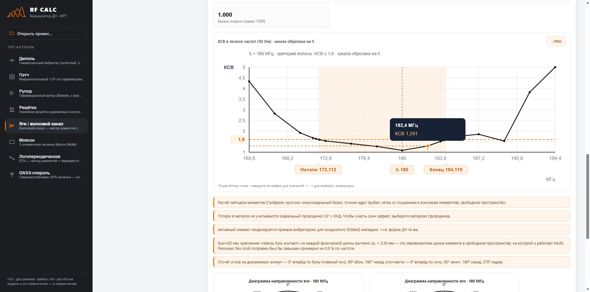

# User guide

[Home](../README.md) · [Fields](FIELDS.md) · [Русский](#русский)

## First calculation

1. Choose **Диполь** (Dipole) in the left sidebar.
2. Select **Проектирование** (Design). Enter frequency, conductor type, conductor size, feed gap and material. Units are shown next to inputs.
3. Wait for the dimension table and pattern result. Calculation starts automatically after an input pause; there is no separate general “Calculate” or “Precise calculation” button in this version.
4. Read the notes. Choose **Добавить в калькулятор** (Use in analysis) to transfer the geometry, then inspect **Поверочный расчёт** (Analysis).
5. Choose **Экспортировать проект** (Export project) to save `.irta`. Use PNG/SVG under a pattern for an image, not a project file.

This workflow illustrates the controls; default dimensions are model examples, not a production drawing or a guaranteed match to your cable.

## Screen layout

The sidebar selects the antenna family and opens project files. The top tabs choose Design or Analysis. The input panel shows a dimensional sketch where available, numeric/select fields, units and information tooltips. The results panel contains design dimensions (in Design), numerical metrics, plots and model notes. Conditional fields appear after selecting the relevant construction/material; hidden values are retained.

Every registered input is documented in the [complete field reference](FIELDS.md): 82 analysis and 60 synthesis definitions. The reference includes exact file keys, UI labels, units, defaults, allowed values and visibility conditions. A range is an input-validation boundary, not proof of model accuracy over that whole range.

## Actions and controls

| Visible control | Meaning and effect |
|---|---|
| Открыть проект… | Open `.irta`; antenna, mode, forms and available saved geometry are restored. Read missing/unknown-field messages. |
| Antenna family in sidebar | Select that model. Save your current work before relying on it across a restart. |
| Проектирование | Start from frequency/targets and calculate an initial geometry. |
| Поверочный расчёт | Calculate from the dimensions you enter. |
| Information icon beside a label | Read the field's contextual explanation. Model limitations in this guide take precedence over historical wording in tooltips. |
| Экспортировать (Design) | Save requirements plus the currently selected calculated/optimized geometry. |
| Экспортировать проект (Analysis) | Save the analysis form and the synthesis form. |
| Добавить в калькулятор | Transfer current design geometry to Analysis for inspection/editing. |
| вернуть исходные | In Design, discard the applied/loaded geometry override and return to synthesis from the current requirements. |
| PNG / SVG beneath E/H plots | Save that pattern as a raster/vector image. |
| PNG at the SWR chart's top right | Save the chart, axes and band annotations as an image. Hover overlays are excluded. |
| Добавить директор / × in Yagi table | Add a director row / remove that row. The added row has starter dimensions; enter the intended geometry. |

There is no dedicated global reset, element-sort action or project-note editor in this UI. A `note` loaded from the file is preserved; edit it in the text file if needed. Export projects before refreshing or closing: the app is not a cloud project library.

[View all eight dimension sketches](ILLUSTRATIONS.md).

## Antenna-specific workflow

| Family | Design inputs and result | Analysis inputs and important limits |
|---|---|---|
| Dipole | Frequency, round/flat conductor, size, gap, metal → resonant starting length | Tip-to-tip length includes feed gap; each arm is `(length-gap)/2`. Flat conductors use an equivalent wire approximation. |
| Patch | Frequency, substrate, thickness, target impedance and polarization → rectangular patch and inset/feed dimensions | Enter **copper** L/W, not PCB outline; ground dimensions are separate. `rect` models the rectangular patch; `beam` uses supplied beamwidth/gain/back-lobe information. CP selection is not an axial-ratio solution or a CP geometry generator. |
| Horn | Frequency and target gain → aperture and flare dimensions | Enter aperture a/b and both flare lengths. Missing flare phase data produces an upper-bound approximation. No feed-transition impedance model or SWR optimizer. |
| Linear array | Target directivity or beamwidth, spacing in wavelengths and progressive phase → element count | Uniform isotropic elements with array-factor calculation, not a Yagi and not a coupled real-element model. |
| Yagi–Uda | Frequency, total element count, diameter, gap, boom/mounting, metal → starting element table | Each row: role, full length, diameter, position along boom. Exactly one `driven` element. Enter physical cut lengths; boom correction is handled by the model. |
| Moxon | Frequency, wire/PCB equivalent size, 50/93-ohm design option and metal → A/B/C/D | A is width, B driven tail, C end gap, D reflector tail; PCB dimensions follow track centrelines. Substrate dielectric effects are not fully solved. |
| LPDA | Low/high frequencies, tau, conductor diameter, feeder impedance and metal → scaled dipoles | Count, tau, sigma, longest length and feed-line parameters define the array. Feed-line impedance is not automatically the measurement-system impedance. |
| GNSS helix assembly | Frequency, number of helices, **single-helix** gain target, pitch and conductor → initial winding geometry | Set winding size/count/height, placement, handedness and screen. Finite screen is a flat wire-grid disk approximation; infinite screen uses ideal image-plane assumptions. Read warnings about adjusted base height. No SWR optimizer. |

### Yagi dimensions

The driven row is the complete tip-to-tip span, including its feed gap. Do not enter the sum of the two metal arms without adding the gap. Positions are along the boom. There is no need to add another boom correction yourself: synthesis adds the physical cutting correction, analysis subtracts it to form the equivalent free-space length. `boomShape` is stored even when inactive. Changing a row's role does not automatically ensure exactly one active element; invalid combinations are reported.

## Size optimization

Optimization is available for dipole, Yagi, Moxon, LPDA and the rectangular patch when the model/input is supported. It is unavailable for horns, uniform arrays, GNSS assemblies and beam-defined patches. The UI explains unavailability.

1. Choose a **Приоритет** (Priority): balance (default), SWR, or gain. These profiles permit different degradation limits: directivity 0.4/1.0/0.1 dB and rear rejection 2/4/1 dB respectively where those metrics apply. “Gain” in the optimization comparison refers to the directivity constraint used by the solver.
2. Set **Полоса оптимизации, %** (0–20). It is the full width around the tuning frequency: endpoints are `f_tune × (1 ± band/200)`. The search checks the centre and both endpoints. Zero tunes one point. Three checks do **not** prove the worst SWR across every intermediate frequency.
3. Set **Смещение настройки, %** (−10 to +10). The tuning centre is `f0 × (1 + offset/100)`.
4. Click **Оптимизировать**. Progress and impedance/full-pattern evaluation counts describe the search. **Прервать** stops it without applying an unfinished candidate.
5. Review the before/after table, changed dimensions, warnings and matching advice. **Применить размеры** updates the active geometry; synthesis exports and transfer use those dimensions too.
6. If shown, **Применить вариант с максимумом усиления** applies a separate candidate that may still require a matching network. It does not manufacture or automatically model that external network.

Editing geometry or changing priority/band settings invalidates the old result. Yagi optimization changes lengths only, keeping positions and diameters fixed. Optimization is a constrained numerical search, not a guarantee of a global optimum or manufacturing tolerance robustness.

## Reading plots and metrics

- **КНД / directivity** describes angular concentration. **КУ / gain** includes modeled efficiency: `G = D × η` in linear units. Mismatch loss is separate; do not subtract it twice.
- **Z** is complex input impedance; **КСВ / SWR** is relative to the reference impedance reported by the calculation/plot. A synthesis target does not mean the input is matched at every frequency.
- **Ширина ДН −3 дБ / HPBW** is the half-power main-lobe width. E/H cuts are model-defined cuts; read each plotted plane label rather than assuming a universal azimuth/elevation orientation.
- **F/B at 180°** and **rear sector ±60°** are different measurements. A deep isolated back null can make F/B look unusually good; the sector metric describes the largest rear emission in that sector.
- The pattern floor controls display clipping, not a physical radiation cutoff. Dashes, warnings or unavailable metrics must not be replaced with assumed numbers.
- SWR samples are actual calculated points joined by lines. Orange annotations identify the threshold, accepted band edges where found and reference frequency. The chart may clip at SWR 5; the tooltip still reports the real sample value. Boundary accuracy is limited by the sweep/search and model.
- Point hover shows crosshairs and values. Focus the chart and use Left/Right to inspect samples; Escape clears selection. Export uses the same data, without hover decorations.

## Project files and practical checks

Use [IRTA.md](IRTA.md) before writing files manually. Keep units, exact enum spelling, both sections and hidden fields. File-format version, internal application generation and public release version are independent numbers. A file saved in Design carries the selected geometry; opening it must not be treated as a request to replace it with fresh default synthesis.

For a first real project: enter known dimensions/materials, save `.irta`, reopen it, check several visible and hidden values, compare selected geometry, then export PNG/SVG and inspect the actual files. Browser downloads use the browser's settings; Tauri uses native dialogs. The existing automated parser tests do not substitute for this OS-specific acceptance check.

---

# Русский

## Первый расчёт

1. Выберите «Диполь» слева и вкладку «Проектирование».
2. Укажите частоту, исполнение, размер проводника, зазор и материал. Единицы указаны рядом с полями.
3. После паузы ввода дождитесь таблицы и ДН. Расчёт автоматический; отдельной общей кнопки «Рассчитать» или «Точный расчёт» в этой версии нет.
4. Прочитайте примечания. «Добавить в калькулятор» переносит геометрию в «Поверочный расчёт».
5. «Экспортировать проект» сохраняет `.irta`; PNG/SVG под графиком сохраняют изображение.

Значения по умолчанию — примеры модели, а не готовая КД и не гарантия согласования с вашим кабелем.

## Экран и все действия

Слева — тип антенны и открытие проекта; сверху — режимы. В форме размещены размерная схема, поля, единицы и подсказки. В результатах — размеры, характеристики, графики и предупреждения. Зависимые поля появляются при выборе соответствующего исполнения; скрытые значения сохраняются.

[Справочник](FIELDS.md#русский) содержит все 142 определения полей: 82 поверочного расчёта и 60 проектирования, с ключами, диапазонами, умолчаниями и условиями видимости. Допустимый диапазон ввода не равен доказанной области физической точности.

| Элемент | Действие |
|---|---|
| Открыть проект… | Восстанавливает тип, режим, формы и сохранённую геометрию. Проверяйте сообщения о пропущенных/неизвестных полях. |
| Тип антенны | Переключает семейство расчёта. Перед перезапуском сохраняйте работу. |
| Проектирование | Требования → начальная геометрия. |
| Поверочный расчёт | Введённая геометрия → характеристики и ДН. |
| Значок информации | Подсказка поля; ограничения модели в руководстве уточняют исторические формулировки подсказок. |
| Экспортировать | В проектировании сохраняет требования и выбранные рассчитанные/оптимизированные размеры. |
| Экспортировать проект | В поверочном режиме сохраняет обе формы. |
| Добавить в калькулятор | Переносит текущие размеры проектирования в поверочный расчёт. |
| вернуть исходные | Убирает применённую/загруженную геометрию и возвращает синтез из текущих требований. |
| PNG / SVG под ДН | Сохраняет выбранную диаграмму. |
| PNG справа сверху графика КСВ | Сохраняет график, оси и подписи, без подсказки наведения. |
| Добавить директор / × | Добавляет строку с начальными размерами / удаляет строку. Новые размеры нужно проверить. |

Отдельных кнопок общего сброса, сортировки элементов и редактора `note` нет. Заметка из файла сохраняется; редактировать её можно в текстовом файле. Сервис облачного хранения проектов не реализован.

[Размерные схемы всех восьми типов](ILLUSTRATIONS.md#русский).

## Особенности восьми типов

| Тип | Проектирование | Поверочный расчёт и ограничения |
|---|---|---|
| Диполь | Частота, провод/полоса, размер, зазор, металл → начальная резонансная длина | Полная длина включает зазор; плечо `(L−зазор)/2`. Полоса заменяется эквивалентным проводом. |
| Патч | Частота, подложка, толщина, целевой импеданс, поляризация → прямоугольный патч и питание | L/W относятся к меди, а не плате. Экран задаётся отдельно. `rect` — модель прямоугольника; `beam` — ДН по заданной ширине/усилению/заднему лепестку. Выбор CP не рассчитывает осевое отношение и не синтезирует CP-рисунок. |
| Рупор | Частота и требуемое усиление → раскрыв и образующие | Нужны размеры a/b и обе образующие. Без фазовых данных — верхняя оценка. Модель перехода питания, импеданс и КСВ-подбор отсутствуют. |
| Решётка | КНД или ширина луча, шаг в λ и фаза → число элементов | Равномерные изотропные элементы и множитель решётки. Это не яги; взаимное влияние реальных излучателей не решается. |
| Яги | Частота, число элементов, диаметр, зазор, бум/крепление, металл → таблица | Роль, полная длина, диаметр и позиция каждого элемента. Активный ровно один. Вводятся физические размеры. |
| Moxon | Частота, провод/PCB, размер, вариант 50/93 Ом и металл → A/B/C/D | A — ширина; B — загиб активного; C — зазор; D — загиб рефлектора. PCB-размеры по осям дорожек; полного решения диэлектрической подложки нет. |
| ЛПА | Нижняя/верхняя частоты, τ, диаметр, импеданс фидера, металл → набор диполей | Число, τ, σ, длина самого большого элемента и фидер задают модель. Импеданс фидера не тождественен опорному сопротивлению измерения КСВ. |
| GNSS | Частота, число спиралей, усиление одной спирали, шаг и проводник → начальная намотка | Задаются диаметр/витки/высота/расстановка, направление и экран. Конечный экран — плоский диск из проволочной сетки; бесконечный — идеальная плоскость. Читайте сообщения о скорректированной высоте основания. КСВ-подбора нет. |

У яги длина активного в таблице включает центральный зазор. Сумму двух металлических плеч нужно увеличить на зазор. Поправку на бум второй раз не добавляют: синтез прибавляет её к размерам для изготовления, анализ вычитает для свободного пространства. `boomShape` сохраняется и в скрытом состоянии. При ручной смене ролей соблюдайте условие одного активного элемента.

## Оптимизация размеров

Доступна для диполя, яги, Moxon, ЛПА и прямоугольного патча при поддерживаемых входах. Для рупора, решётки, GNSS и патча по ширине луча выводится причина недоступности.

1. Выберите приоритет: баланс / КСВ / усиление. Допустимое снижение КНД соответственно 0,4 / 1,0 / 0,1 дБ, заднего подавления — 2 / 4 / 1 дБ, где эти метрики применимы. Ограничение усиления в подборе относится к используемому решателем КНД.
2. Полоса 0–20% — полная ширина вокруг частоты настройки: края `f_настр × (1 ± полоса/200)`. Проверяются центр и два края. Ноль — одна точка. Три точки не доказывают максимум КСВ на всей непрерывной полосе.
3. Смещение −10…+10% задаёт центр `f0 × (1 + смещение/100)`.
4. «Оптимизировать» запускает подбор; «Прервать» останавливает без применения незавершённого кандидата.
5. Изучите «было/стало», изменения размеров, предупреждения и советы; нажмите «Применить размеры». Таблица, ДН, экспорт и перенос используют выбранные размеры.
6. Альтернатива максимального усиления может требовать согласующего устройства. Её применение само по себе не моделирует внешнюю согласующую цепь.

Изменение геометрии/приоритета/полосы сбрасывает старый результат. У яги меняются только длины, позиции и диаметры фиксированы. Подбор не гарантирует глобального оптимума и устойчивости к производственным допускам.

## Графики и результаты

- КНД характеризует направленность; КУ учитывает КПД: `G = D × η` в линейных единицах. Рассогласование показано отдельно, не вычитайте его дважды.
- Z — комплексный входной импеданс; КСВ относится к указанному в расчёте опорному сопротивлению. Цель синтеза не означает согласование на всех частотах.
- Ширина −3 дБ — ширина главного лепестка по половинной мощности. Ориентацию E/H смотрите по подписям конкретной модели.
- F/B строго на 180° отличается от заднего сектора ±60°. Узкий случайный провал может завысить F/B; сектор отражает худшее заднее излучение в выбранном секторе.
- Нижний предел шкалы обрезает рисунок, а не физическое излучение. Прочерки и недоступные метрики не заменяйте предполагаемыми числами.
- Точки КСВ рассчитаны, линии соединяют их. Оранжевым отмечены порог, найденные границы полосы и опорная частота. Шкала может быть обрезана на 5, но подсказка показывает фактическое значение точки.
- Наведение показывает перекрестие и данные. После фокусировки графика работают Left/Right; Escape убирает выделение. PNG не содержит перекрестия.

## Файлы и проверка рабочего проекта

Перед ручной генерацией прочитайте [IRTA](IRTA.md#русский). Сохраняйте обе формы, скрытые поля, единицы и точные значения списков. Версия формата, внутренняя версия приложения и публичный выпуск — разные номера. При открытии проекта синтеза должна восстанавливаться выбранная геометрия, а не подменяться новым синтезом из умолчаний.

Для первого рабочего проекта: введите реальные данные, сохраните `.irta`, откройте снова, сверьте видимые/скрытые значения и геометрию, сохраните PNG/SVG и проверьте сами файлы. Браузер использует свои настройки загрузок, Tauri — системные диалоги. Тесты парсера не заменяют приёмку файловых действий на конкретной ОС.
